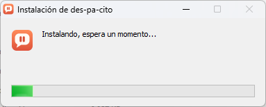
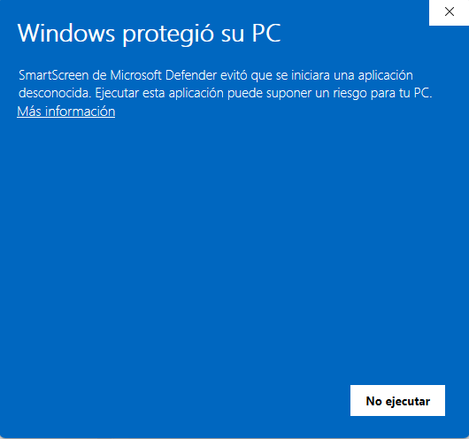
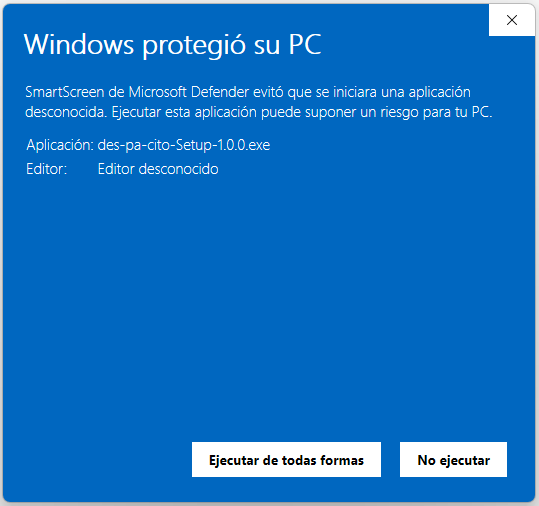
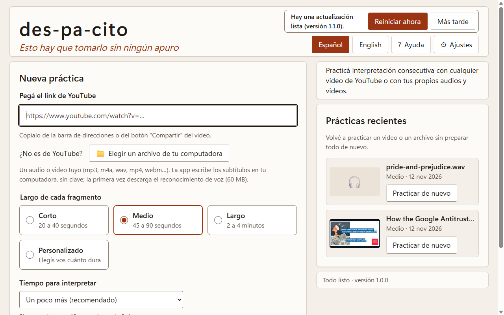

# Instalación

Instalar des-pa-cito lleva un minuto. No hace falta ser administrador de la computadora ni instalar nada
más. Funciona en **Windows 11** (y en Windows 10).

## 1. Descargá el instalador

Entrá a la [página de descargas](https://github.com/eldanialonso/des-pa-cito-releases/releases/latest) y, en
**Assets**, hacé clic en **des-pa-cito-Setup-** seguido del número de versión (termina en **.exe**). Se
guarda en tu carpeta **Descargas**.

## 2. Abrí el instalador

Hacé doble clic en el archivo que descargaste. La primera vez, Windows muestra un aviso (ver abajo).
Después la app se instala sola, sin preguntas, y se abre al terminar:

Deja un acceso directo **des-pa-cito** en el escritorio y en el menú Inicio.

## Si Windows dice "Windows protegió su PC"

La primera vez, Windows muestra un cartel azul que dice **"Windows protegió su PC"**. Aparece porque la
app todavía no tiene una firma digital (cuesta dinero y por ahora no la tiene), no porque tenga un
problema.

1. Tocá **"Más información"** (es un link, abajo del texto). **No toques "No ejecutar"**: eso cancela la
   instalación.

   

2. Aparece el nombre del archivo (`des-pa-cito-Setup-…exe`), "Editor desconocido" y un botón nuevo: tocá
   **"Ejecutar de todas formas"**.

   

Windows lo pregunta una sola vez: después la app se abre normalmente.

## Si Windows dice que "Control inteligente de aplicaciones" bloqueó la app

Algunas computadoras con Windows 11 tienen activado el **Control inteligente de aplicaciones** (en
inglés, *Smart App Control*). Es más estricto que el cartel azul: puede bloquear las apps que no tienen
firma digital y **no ofrece un botón para abrirlas igual**.

Si te pasa:

- No es un virus ni un error tuyo: es porque la app todavía no tiene firma digital.
- Si la computadora es del trabajo o de una institución, consultá con quien la administra.
- Si es tuya, la explicación oficial de Microsoft está en Inicio → Configuración → Privacidad y
  seguridad → Seguridad de Windows → Control de aplicaciones y navegador.

## La primera vez que la abrís

La app te ofrece crear tu **clave gratuita de Google** para que las pausas caigan al final de cada idea
(unos 2 minutos). Podés hacerlo o tocar **"Probar sin IA"**. Seguí con
[Primeros pasos](primeros-pasos.md).

## Actualizaciones

No tenés que hacer nada. La app busca versiones nuevas sola (al abrirse y cada 6 horas) y las descarga
sin interrumpirte. Cuando hay una lista, aparece un aviso arriba a la derecha (en una línea propia, si la
ventana es angosta), dentro del encabezado de la pantalla de inicio, de Ajustes o de la Ayuda:

- **Reiniciar ahora:** la app se cierra, se actualiza y se vuelve a abrir en unos segundos.
- **Más tarde:** seguís usando la app; la actualización se instala sola la próxima vez que la cierres.

El aviso nunca aparece en medio de una práctica. También podés buscar actualizaciones a mano en
**⚙ Ajustes → Actualizaciones**, donde además ves qué versión tenés.

Tus ajustes, tu clave y tus prácticas recientes se conservan al actualizar.

## Desinstalar

1. Abrí **Inicio → Configuración → Aplicaciones → Aplicaciones instaladas**.
2. Buscá **des-pa-cito**, tocá los tres puntos **⋯** y elegí **Desinstalar**.

Se borran la app y sus accesos directos. Tus ajustes y tu clave quedan guardados en la computadora por si
la volvés a instalar.
