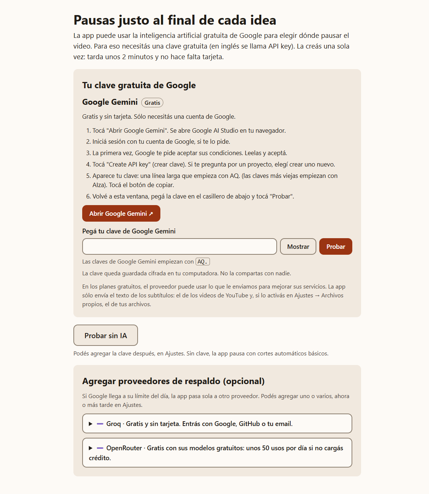
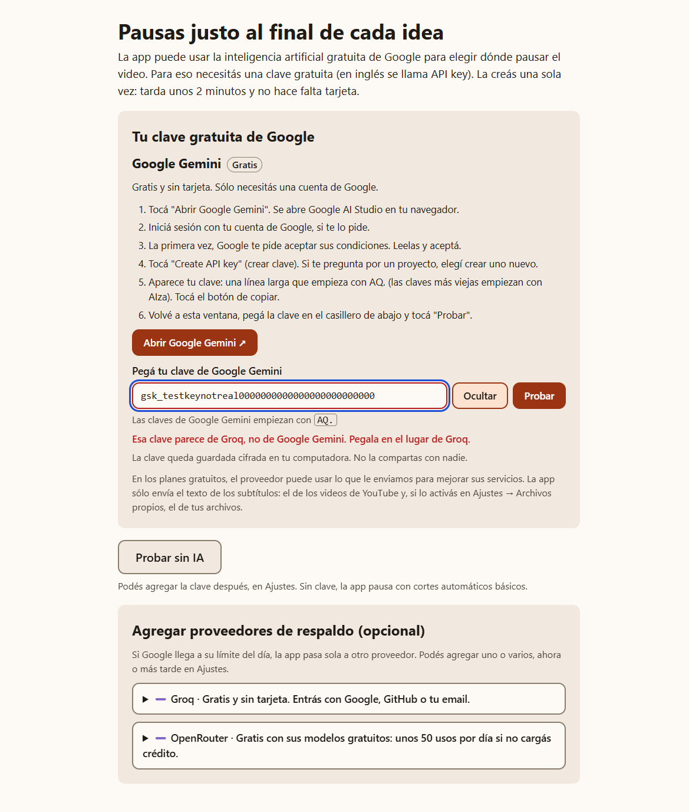

# Cómo obtener tu clave gratuita de Google

des-pa-cito usa la inteligencia artificial de Google (Gemini) para decidir dónde pausar el video.
Para eso necesitás una **clave gratuita** (en inglés, *API key*). La creás una sola vez.

- ⏱ Tarda unos 2 minutos.
- 💳 **No** necesitás tarjeta de crédito.
- 👤 Sólo necesitás una cuenta de Google (por ejemplo, la de Gmail).

La primera vez que abrís la app aparece este asistente, con los mismos pasos que ves abajo. También lo
encontrás después en **⚙ Ajustes → Inteligencia artificial** (botón **"Agregar clave"** de Google Gemini).

## Paso a paso

1. Entrá a **Google AI Studio**: <https://aistudio.google.com/apikey>
   (en la app, el botón **"Abrir Google Gemini"** abre esta página en tu navegador).
2. **Iniciá sesión** con tu cuenta de Google, si te lo pide.
3. La primera vez, Google te pide **aceptar sus condiciones**. Leelas y aceptá.
   <!-- img: img/google-01-condiciones.png -->
4. Tocá **"Create API key"** (Crear clave de API).
   Si te pregunta por un "proyecto", elegí la opción de **crear uno nuevo**: Google lo arma solo.
   <!-- img: img/google-02-crear-clave.png -->
5. Aparece tu clave: una línea larga que empieza con **`AQ.`** (las claves más viejas empiezan con `AIza`; también sirven). Tocá el botón de **copiar** 📋.
   <!-- img: img/google-03-copiar.png -->
6. Volvé a la app, **pegá la clave** en el casillero y tocá **"Probar"**.
7. Si ves **✅ ¡Listo! Funciona**, ya está. 🎉

## Preguntas rápidas

**¿Me van a cobrar?** No. La clave usa el plan gratuito de Google. Tiene un límite de usos por minuto y
por día; para practicar alcanza de sobra. Si algún día se llega al límite, la app usa otro proveedor que
tengas configurado o, si no hay, pausas automáticas básicas.

**¿Es segura?** La clave queda guardada cifrada en tu computadora. No la compartas con nadie: es como una
contraseña.

**¿Qué datos se envían?** Sólo el texto de los subtítulos del video que elegiste. De tus propios archivos,
nada, salvo que le digas que sí a la app cuando te pregunta si puede usar la IA para sus pausas (o lo
prendas en **Ajustes → Archivos propios**). En el plan gratuito, Google puede usar esos datos para mejorar sus servicios.

**¿Y si pego la clave de otro proveedor?** La app te avisa antes de probarla:

**Me sale ⚠️ "La clave no funciona".**
- Revisá que la copiaste **completa**, sin espacios al principio ni al final.
- Revisá que empiece con `AQ.` (o `AIza`, si es una clave vieja).
- Si recién la creaste, esperá un minuto y probá de nuevo.
- Si sigue sin andar, creá una clave nueva repitiendo los pasos 4 y 5.

**¿La perdí o la quiero cambiar?** Volvé a <https://aistudio.google.com/apikey>: ahí ves tus claves, podés
copiarlas otra vez, crear una nueva o borrar una vieja.

**¿Quiero opciones de respaldo?** Mirá [Proveedores de respaldo](proveedores-de-respaldo.md) (opcional).
