# Primeros pasos

Con des-pa-cito practicás interpretación consecutiva con cualquier video de YouTube, o con un audio o
video tuyo ([más abajo](#practicar-con-un-archivo-tuyo)). La app pone el video, **pausa sola** al terminar
cada fragmento, te da tiempo para interpretar y **sigue sola**.

## 0. La primera vez: tu clave gratuita de Google (opcional)

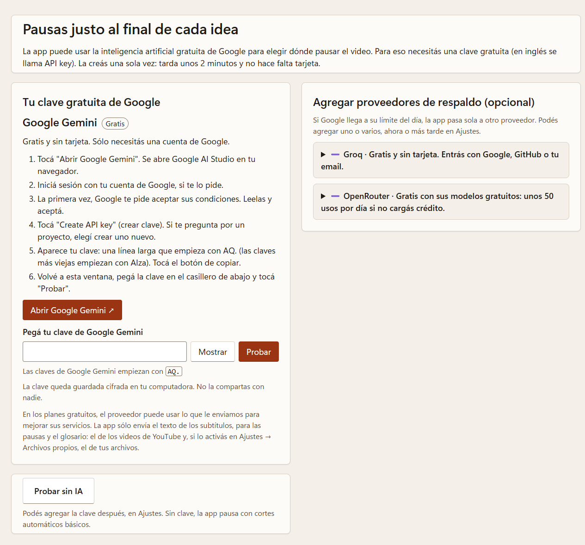

La primera vez que abrís la app, te ofrece usar la **inteligencia artificial gratuita de Google** para que
las pausas caigan justo al final de cada idea. Seguí los pasos de la pantalla: tocá **"Abrir Google
Gemini"**, creá la clave, pegala y tocá **"Probar"**. Si ves **✅ ¡Listo! Funciona**, ya está.

¿Preferís no hacerlo ahora? Tocá **"Probar sin IA"**, debajo: la app pausa igual, con cortes automáticos
básicos (en silencios y al final de las oraciones). Podés agregar la clave cuando quieras desde
**⚙ Ajustes**. Guía completa: [Cómo obtener tu clave gratuita de Google](obtener-api-key-google.md).

A la derecha (abajo, si la ventana es angosta) podés sumar
[proveedores de respaldo](proveedores-de-respaldo.md), si querés.

Si pegás algo que no es una clave de Google (por ejemplo, una de otro proveedor, o con espacios en el
medio), la app te lo dice antes de probarla:

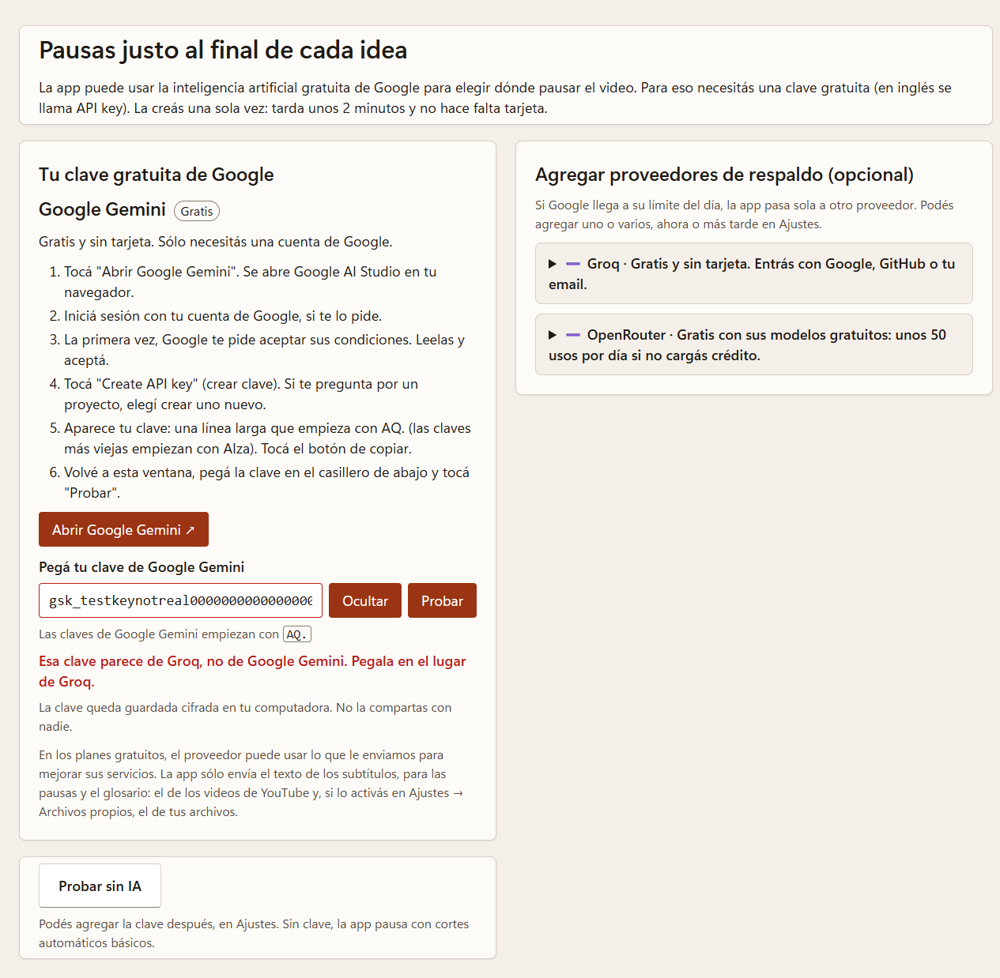

## 1. Pegá el link y elegí el nivel

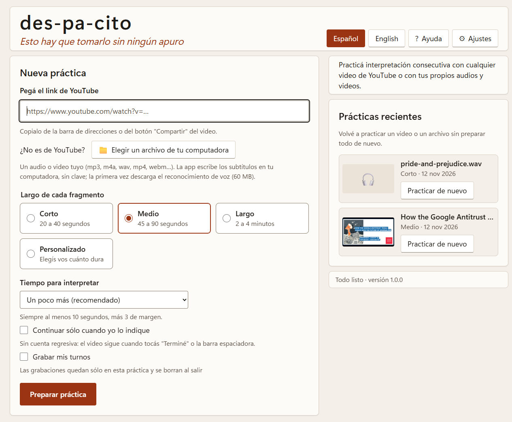

1. En YouTube, copiá el link del video (de la barra de direcciones o del botón **"Compartir"**).
2. Pegalo en **"Pegá el link de YouTube"**.
3. Elegí el **largo de cada fragmento**:
   - **Corto:** 20 a 40 segundos.
   - **Medio:** 45 a 90 segundos (para empezar, es el más cómodo).
   - **Largo:** 2 a 4 minutos.
   - **Personalizado:** escribís el mínimo y el máximo de segundos que quieras (desde 10 segundos hasta
     10 minutos, con el máximo al menos 10 segundos más que el mínimo). Si algo no cuadra, la app te dice
     qué cambiar.
4. Elegí cuánto **tiempo para interpretar** querés. "Un poco más" te da un poco más de lo que dura el
   fragmento, y nunca menos de 10 segundos.
5. Tocá **"Preparar práctica"**. La app busca los subtítulos del video y calcula dónde pausar. Con IA puede
   tardar un poco más; si no querés esperar, tocá **"Seguir sin IA"** y empezás enseguida con cortes
   automáticos básicos.

El video tiene que tener subtítulos en su idioma (los de YouTube, aunque sean automáticos). Si no los
tiene y configuraste tu clave de Google, la IA de Google los escribe (las pausas pueden ser un poco menos
precisas). Sin clave, la app te avisa y te ofrece configurarla.

Si algo sale mal, la app te dice qué pasó y te ofrece qué hacer: probar de nuevo, elegir otro video,
configurar tu clave o ver los problemas frecuentes. Por ejemplo, si YouTube está limitando las descargas, te
dice a qué hora podés volver a intentar:

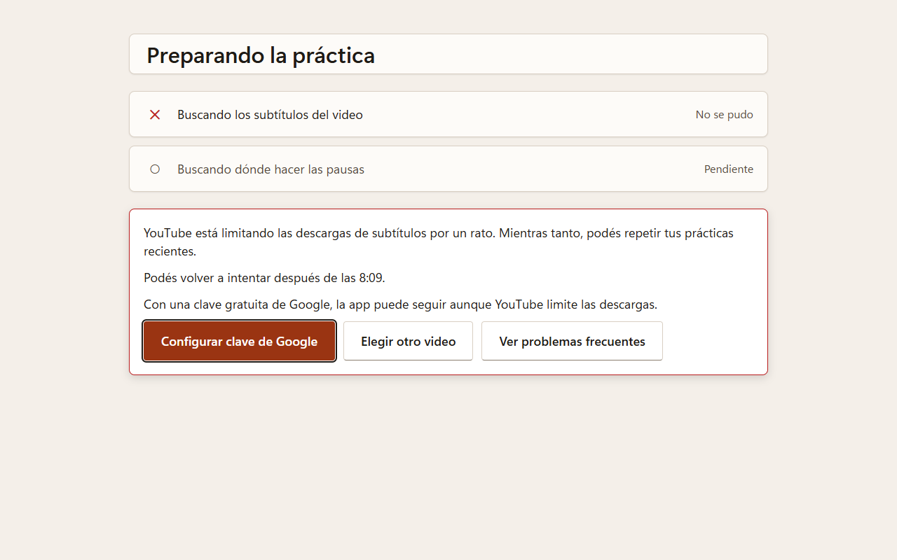

## 2. Practicá

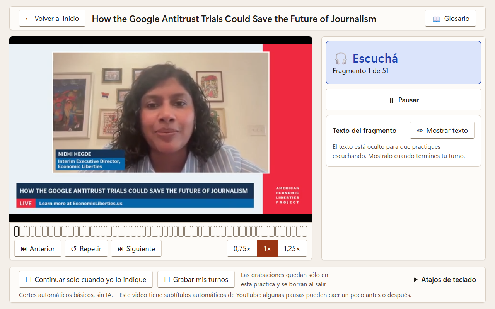

- Tocá **"Empezar"** (o la barra espaciadora). A la derecha del video (debajo, si la ventana es angosta)
  dice **🎧 Escuchá**. Ahí mismo están los botones y el texto del fragmento.
- Al terminar el fragmento, el video se pausa y aparece **🗣 Tu turno** con una cuenta regresiva. Es tu
  momento de interpretar.
- Cuando la cuenta llega a cero, el video sigue solo. Si terminaste antes, tocá **"Terminé"**.
  ¿Necesitás más tiempo? Tocá **"+10 s"**.
- Mientras es tu turno, **"Anterior"**, **"Repetir"**, **"Siguiente"** y la barra de fragmentos se ven
  apagados: es tu momento de hablar. Si pausás tu turno se vuelven a prender, y entonces cualquiera de
  ellos termina tu turno, igual que "Terminé" (te lo recuerda una línea debajo de los botones). Para
  sacar la pausa, tocá **"Reanudar"**.

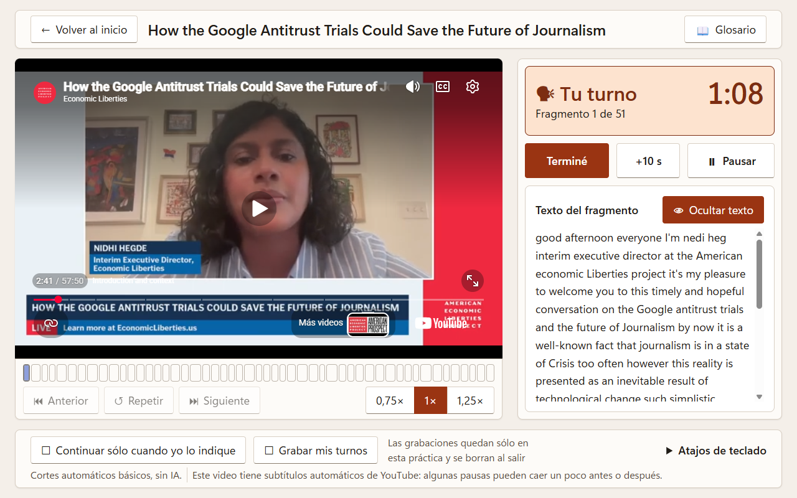

- El **texto del fragmento** está oculto para que practiques escuchando. Cuando termines tu turno,
  tocá **"Mostrar texto"** (en la tarjeta del texto) para compararlo con lo que dijiste.
- Justo **debajo del video** está la **barra de fragmentos**: muestra en qué parte del video estás. Tocá
  un bloque para ir a ese fragmento. Con el teclado, la barra es un solo lugar: con ← y → cambiás de fragmento, e
  **Inicio** y **Fin** te llevan al primero y al último.
- Debajo de la barra, en una sola fila: **"Anterior"** y **"Siguiente"** te mueven de a uno y
  **"Repetir"** vuelve a poner el fragmento. A la derecha, la **velocidad**: podés escuchar más lento
  (0,75×) o más rápido (1,25×).
- En la franja de abajo de todo:
  - **"Continuar sólo cuando yo lo indique"**: si lo activás, no hay cuenta regresiva y el video sigue
    recién cuando tocás "Terminé".
  - **"Grabar mis turnos"** (al lado): graba lo que decís en tu turno para que te escuches después. Mirá
    [Grabar tus turnos](#grabar-tus-turnos).
  - **"Atajos de teclado"**, a la derecha: tocalo para ver la lista.

En esa misma franja, abajo, dice **quién eligió las pausas**: la IA (y cuál) o "Cortes automáticos
básicos, sin IA". Si tenías IA configurada pero no respondió (por ejemplo,
porque se terminó el cupo gratuito del día), la app sigue igual con cortes básicos y te lo avisa: "Usamos
cortes automáticos básicos porque no hubo respuesta de la IA".

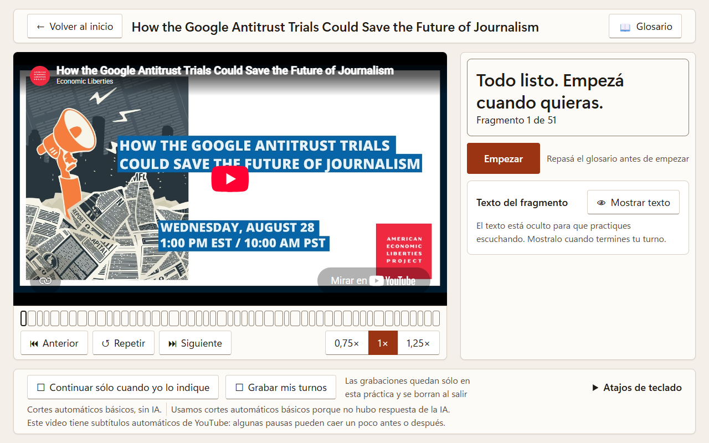

Al terminar el último fragmento, la app te muestra cuántos practicaste y podés tocar **"Volver a
empezar"** o **"Elegir otro video"**.

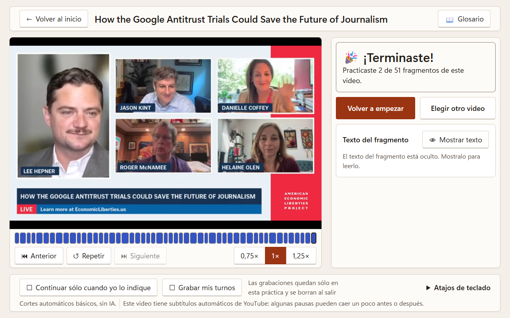

## Grabar tus turnos

¿Querés escucharte después de interpretar? Prendé **"Grabar mis turnos"**. Viene apagada. Está en tres
lugares: en la pantalla de inicio (debajo de "Continuar sólo cuando yo lo indique"), en **Ajustes →
Práctica** y en la práctica misma, en la franja de abajo de todo.

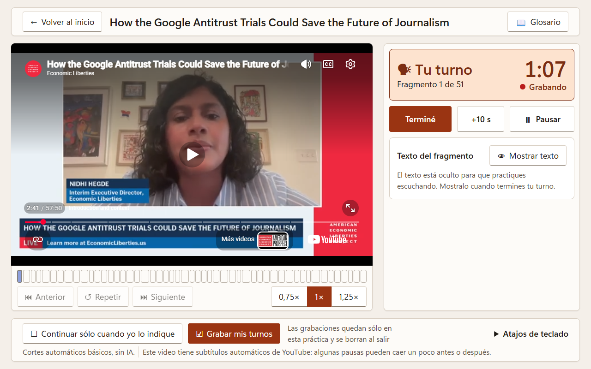

- La app usa el **micrófono de Windows** (el que Windows tenga elegido). Al prender la opción, la app lo
  prueba en ese momento. Si no anda, la opción se vuelve a apagar y la app te dice por qué, ahí mismo
  ([más abajo](#si-el-micrófono-no-anda)).
- Sólo graba **durante tu turno**: empieza después del sonido de turno (si lo tenés prendido) y, mientras
  graba, al lado de "🗣 Tu turno" (debajo de la cuenta regresiva) dice **● Grabando**.
- Si pausás tu turno, la grabación se pausa; al tocar **"Reanudar"**, continúa. **"+10 s"** no la corta.
  **"Terminé"** o el fin del tiempo la terminan, y también **"Repetir"**, **"Anterior"** o **"Siguiente"**
  con el turno en pausa. Lo grabado hasta ahí se guarda.
- Hay **una grabación por fragmento**: si volvés a interpretar el mismo fragmento, la nueva reemplaza a la
  anterior. Si dura menos de un segundo, no se guarda.

**Escucharte:**

- Con la práctica **en pausa**, a la derecha del video, debajo de los botones, aparecen **"🔊 Escuchar mi
  interpretación"** y **"🔁 Original y después mi interpretación"** (el fragmento del video y, enseguida, lo que dijiste). Si
  pausaste en medio de tu turno, escuchás lo que llevás dicho; al reanudar, la grabación continúa.
- Al **terminar la práctica**, a la derecha del video aparece **"Tus grabaciones"**, con una línea por cada
  fragmento que grabaste y sus dos botones.
- Cuando termina de sonar, la práctica queda como estaba. Para cortar antes, tocá **"Dejar de escuchar"**,
  la barra espaciadora o **Esc**. Repetir, Anterior, Siguiente, Terminé o la barra de fragmentos también
  lo cortan; **"Mostrar texto"**, el glosario y la velocidad no (podés leer el texto mientras te escuchás).
  Escucharte no cuenta como un turno nuevo ni graba nada.

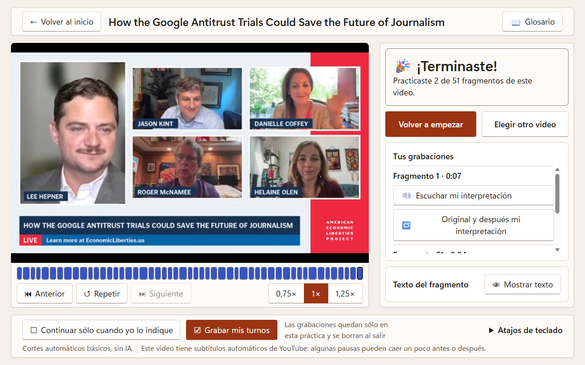

**Tus grabaciones son privadas:** quedan **sólo en la memoria de la app** mientras dura la práctica. No se
guardan en tu computadora y no se envían a ningún lado. Se borran al volver al inicio, al cerrar la app o
si el video falla y tocás "Probar de nuevo" (la app no pregunta antes). El micrófono se abre al entrar a la
práctica, así no se pierden tus primeras palabras, y se cierra al salir de ella.

### Si el micrófono no anda

Cuando la opción no se puede prender, la app te dice qué pasa y te ofrece **"Abrir la configuración del
micrófono de Windows"**:

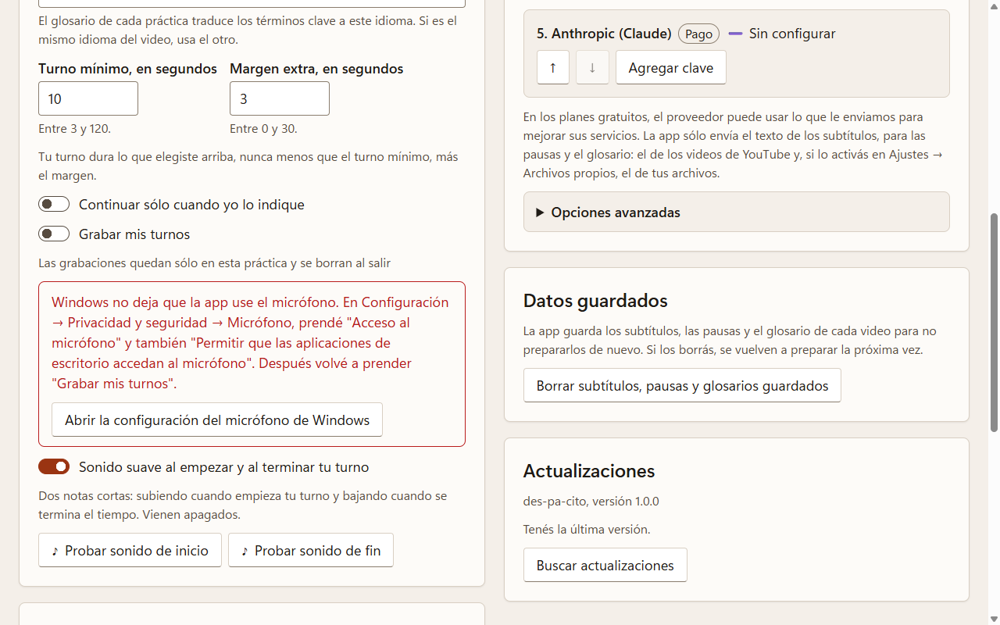

- **"Windows no deja que la app use el micrófono":** tocá el botón y, en **Privacidad y seguridad →
  Micrófono**, prendé **"Acceso al micrófono"** y también **"Permitir que las aplicaciones de escritorio
  accedan al micrófono"**. Después volvé a prender "Grabar mis turnos".
- **"No encontramos un micrófono":** conectá uno (o unos auriculares con micrófono) y volvé a prender la
  opción.
- **"El micrófono está ocupado o no responde":** cerrá las otras aplicaciones que lo estén usando (una
  videollamada, por ejemplo) y volvé a prender la opción.

Si desconectás el micrófono durante la práctica, la opción se apaga y la app te avisa al terminar tu turno.

## El glosario

Si la IA eligió las pausas, también arma un **glosario**: los nombres, las siglas y los términos
importantes del video, cada uno con una traducción sugerida y, a veces, una nota corta (por ejemplo, qué
quiere decir una sigla). Van en el orden en que aparecen en el video. Antes de empezar, la app te
recuerda: "Repasá el glosario antes de empezar".

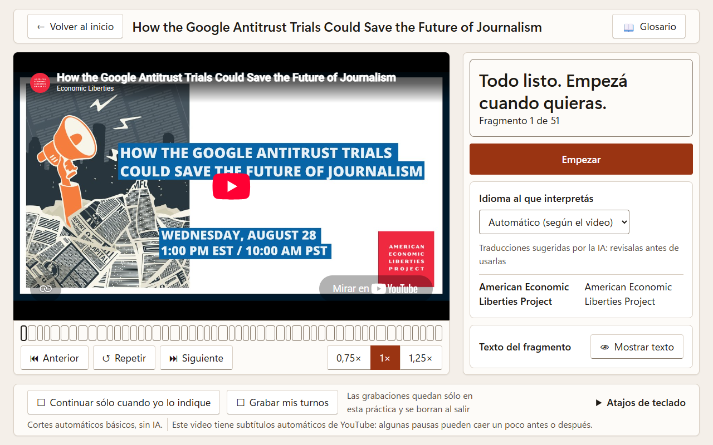

- Tocá **"📖 Glosario"** (arriba a la derecha, al lado del título) o la tecla **G** para abrirlo o cerrarlo.
  Se abre a la derecha del video, debajo de los botones, en el lugar del texto del fragmento, hasta que lo
  cerrás (si la ventana es angosta, va debajo de la barra de fragmentos y el texto sigue más abajo). El
  video y la barra de fragmentos no cambian. Si es largo, se desplaza por dentro. Abrirlo no muestra el
  texto del fragmento: el glosario no trae frases del video. Si tocás **"Mostrar texto"** (queda debajo del
  glosario), el glosario se cierra para que veas el texto.
- Mientras dice **"Armando el glosario…"**, la lista se va llenando sola; podés empezar a practicar igual.
- Las traducciones las sugiere la IA: **revisalas antes de usarlas**.
- **Idioma al que interpretás:** en automático, un video en inglés se traduce al castellano y uno en
  castellano, al inglés. Lo podés cambiar arriba del glosario o en **Ajustes → Práctica**. Si elegís el
  mismo idioma del video, la app usa el otro y te lo dice.
- **"El glosario necesita una clave de IA":** tocá **"Configurar una clave"**. Los pasos para conseguirla se
  abren ahí mismo, en el glosario, sin salir de la práctica. Si la práctica se preparó sin ninguna clave, la
  clave nueva sirve para las próximas: esa práctica no tiene glosario.
- **"Ahora no se pudo armar el glosario (límite de uso gratuito)":** se terminó el cupo gratuito por un
  rato. Queda lo que ya salió; tocá **"Reintentar"** más tarde.
- Las prácticas que hiciste antes de que existiera el glosario no lo arman solas: tocá **"Armar glosario"**.
- Si elegiste **"Seguir sin IA"**, o la IA no respondió y la app usó cortes automáticos básicos, esa práctica
  no tiene glosario.

## Atajos de teclado

Podés practicar sin mouse. En la práctica, abajo a la derecha, **"Atajos de teclado"** te los recuerda:

| Tecla | Qué hace |
|---|---|
| Espacio | Empezar · pausar o reanudar mientras escuchás · **terminar tu turno** cuando es tu turno |
| P | Pausar o reanudar |
| R | Repetir el fragmento (en tu turno, sólo en pausa) |
| ← y → | Fragmento anterior o siguiente (en tu turno, sólo en pausa) |
| + | 10 segundos más para tu turno |
| T | Mostrar u ocultar el texto |
| G | Abrir o cerrar el glosario |
| Espacio o Esc | Dejar de escuchar tu interpretación ([Grabar tus turnos](#grabar-tus-turnos)) |

Con **Tab** pasás de un botón a otro y con **Enter** lo activás. Si la ventana es grande, cada botón
muestra su tecla al lado; si no, la ves al dejar el mouse quieto sobre el botón.

Si querés, la app puede hacer un **sonido suave** cuando empieza tu turno y cuando se termina el tiempo:
prendelo en **Ajustes → Práctica**.

## Practicar con un archivo tuyo

¿Tenés una clase grabada, un discurso o un podcast en tu computadora? También sirve.

1. En la pantalla de inicio, debajo del link, tocá **"Elegir un archivo de tu computadora"**.
2. Elegí el archivo: audio o video (mp3, m4a, wav, mp4, webm y otros).
3. Si configuraste una clave de IA, la app te pregunta primero: **"¿Usar la IA para las pausas y el
   glosario de este archivo?"**. Con IA, las pausas caen mejor al final de cada idea y tenés un
   [glosario](#el-glosario), pero el texto de los subtítulos del archivo se envía a tu servicio de IA (por
   ejemplo, Google); el audio y el video no se envían. Sin IA, la app hace cortes automáticos básicos, sin
   glosario, y nada del archivo sale de tu computadora. Tocá **"Sí, usar IA"** o
   **"No, sólo en mi computadora"**. La próxima vez te vuelve a preguntar, con tu respuesta anterior
   marcada; si tildás **"No volver a preguntar"**, recuerda tu respuesta. Sin clave de IA, no pregunta:
   usa los cortes automáticos. Si ya le habías dicho que sí antes de que existiera el glosario, ese sí vale
   también para el glosario: se envía el mismo texto al mismo servicio.

   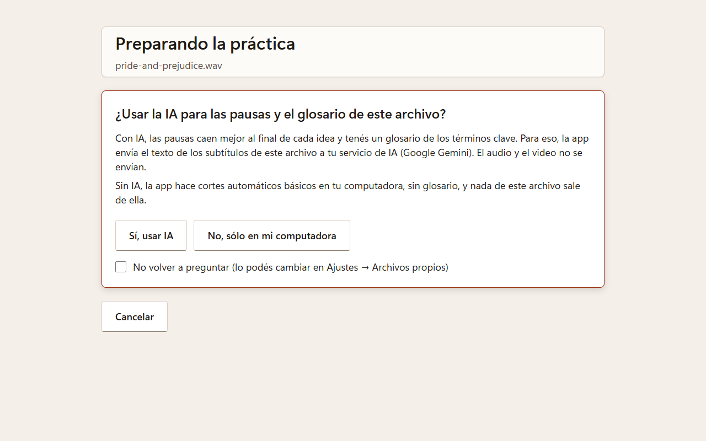

4. La app escribe los subtítulos **en tu computadora**, sin clave. La primera vez descarga el
   reconocimiento de voz (60 MB, una sola vez). Un audio de 20 minutos tarda unos 2 o 3 minutos.

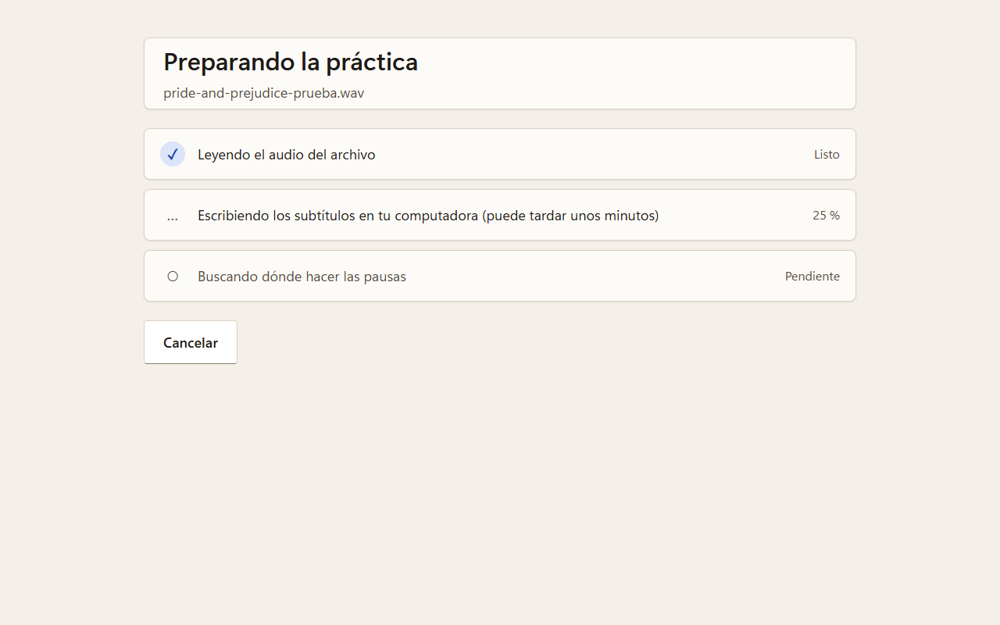

Después practicás igual que con YouTube: las mismas pausas, el mismo turno y los mismos atajos.

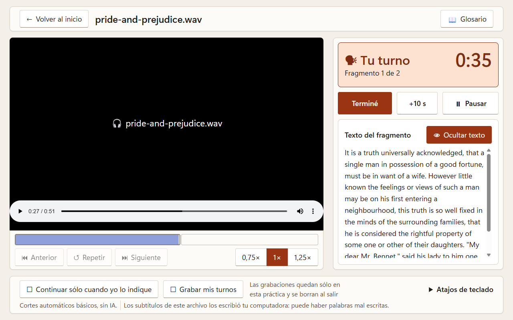

- Los subtítulos los escribe tu computadora: a veces erra un nombre o una palabra. Las pausas caen al final
  de las oraciones.
- El archivo no sale de tu computadora. El texto de sus subtítulos (para las pausas y el glosario), sólo si
  le dijiste que sí a la IA.
- Si movés o renombrás el archivo, la práctica desaparece de "Prácticas recientes": elegilo de nuevo.
- Para audios en castellano conviene la **Mejor calidad** (en **Ajustes → Archivos propios**): tarda un poco
  más y la primera vez descarga 190 MB. Si la elegís después, los archivos que ya practicaste se vuelven a
  escribir con la Mejor calidad la próxima vez que los abras.
- Cada archivo puede durar hasta 3 horas. Los .webm, .ogg, .opus y .flac, hasta 20 minutos: para uno más
  largo, usá un .mp4, .m4a, .mov, .mp3 o .wav.

## Prácticas recientes

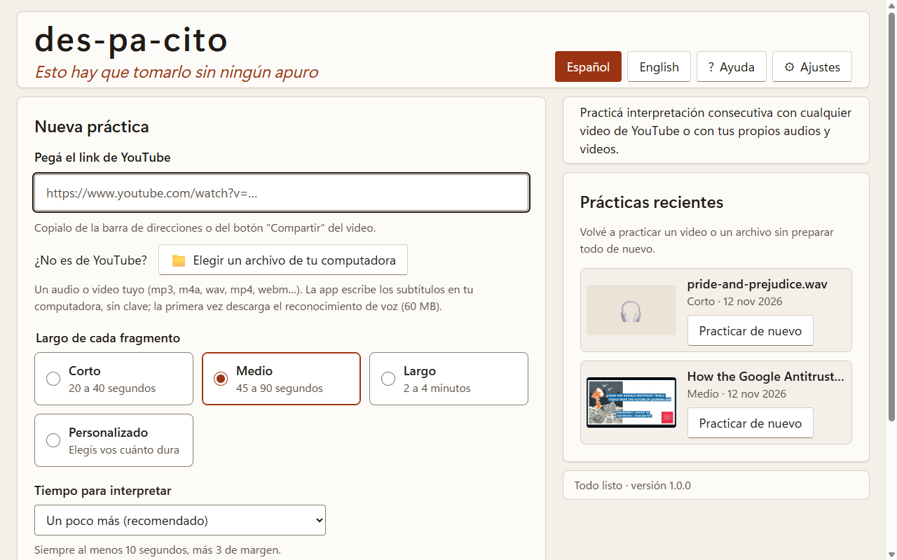

En la pantalla de inicio, a la derecha de "Nueva práctica" (abajo, si la ventana es angosta), aparecen los
videos y archivos que ya practicaste. Tocá **"Practicar de nuevo"**: como los subtítulos quedaron
guardados en tu computadora, no hace falta buscarlos otra vez.

## Idioma de la app

Arriba a la derecha de la pantalla de inicio (o en **⚙ Ajustes**) elegís **Español** o **English**. La app
lo recuerda.

## La ventana

La app **recuerda el tamaño y el lugar de su ventana**, y si estaba maximizada: la próxima vez abre igual.
Si ese lugar ya no se ve (por ejemplo, desconectaste un monitor), abre en el centro de la pantalla. Si
quedó más grande que tu pantalla (por ejemplo, cambiaste de monitor o de resolución), se achica para
entrar entera.

En Windows 11, el fondo de la ventana toma un tono suave de tu fondo de escritorio, como las ventanas de
Windows. Los textos van siempre sobre un fondo liso, así se leen igual.

## Ajustes

Tocá **⚙ Ajustes** en la pantalla de inicio.

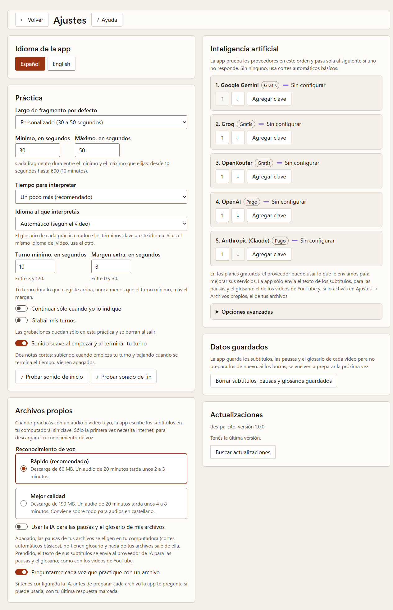

Las opciones que se prenden y se apagan son **interruptores**: el cambio vale al instante, sin botón
para guardar. Con la ventana ancha, las opciones van en dos columnas: a la izquierda el idioma, la práctica
y tus archivos; a la derecha la inteligencia artificial, los datos guardados y las actualizaciones.

- **Idioma de la app.**
- **Práctica:** largo de fragmento por defecto (también **Personalizado**), tiempo para interpretar, el
  **idioma al que interpretás** (para el [glosario](#el-glosario): "Automático (según el video)",
  "Castellano" o "Inglés"), **turno mínimo** y **margen extra** (en segundos), "Continuar sólo cuando yo lo indique", **"Grabar mis
  turnos"** ([Grabar tus turnos](#grabar-tus-turnos)) y el **sonido suave** al
  empezar y al terminar tu turno (viene apagado; con **"Probar sonido de inicio"** y **"Probar sonido de
  fin"** lo escuchás antes).
- **Archivos propios:** el reconocimiento de voz para tus archivos, **Rápido** (recomendado) o **Mejor
  calidad** (más lento; conviene para audios en castellano); **"Usar la IA para las pausas y el glosario
  de mis archivos"** (tu última respuesta a la pregunta) y **"Preguntarme cada vez que practique con un
  archivo"**: si tildaste "No volver a preguntar", prendelo para que la app vuelva a preguntar.
- **Inteligencia artificial:** la lista de proveedores con su estado (✅ funciona · ⚠️ la clave no funciona ·
  ⏳ sin cupo hasta cierta hora · ➖ sin configurar). La app los prueba **en este orden** y pasa sola al
  siguiente si uno no responde; con ↑ y ↓ cambiás el orden. Con **"Agregar clave"** aparecen los pasos para
  crearla; también podés **probar** o **quitar** una clave. Más proveedores gratuitos de respaldo:
  [Proveedores de respaldo](proveedores-de-respaldo.md).
- **Opciones avanzadas** (cerradas): qué modelo usa cada proveedor. Si no sabés qué es, no lo toques.
- **Datos guardados:** **"Borrar subtítulos, pausas y glosarios guardados"** (se vuelven a preparar la
  próxima vez).
- **Actualizaciones:** qué versión tenés y el botón **"Buscar actualizaciones"** (la app igual las busca
  sola). Más en [Instalación y actualizaciones](instalacion.md#actualizaciones).

Si una clave deja de funcionar, la vas a ver así:

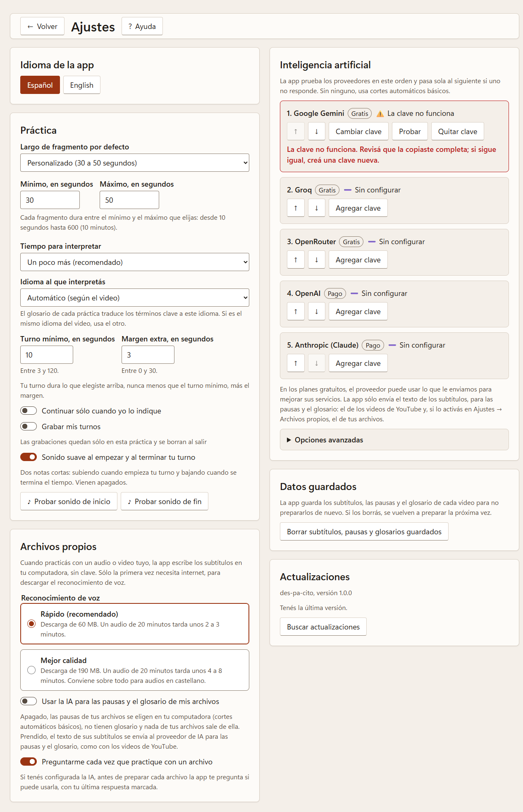

## Ayuda

Tocá **? Ayuda** en la pantalla de inicio o en Ajustes para leer estas guías dentro de la app, sin
internet: primeros pasos, tu clave de Google, proveedores de respaldo,
[problemas frecuentes](problemas-frecuentes.md) e [instalación y actualizaciones](instalacion.md). La
lista de guías queda a la izquierda mientras leés (arriba, si la ventana es angosta).

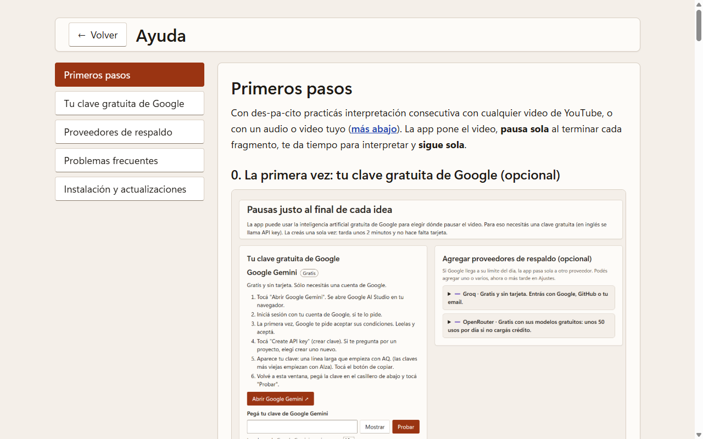
