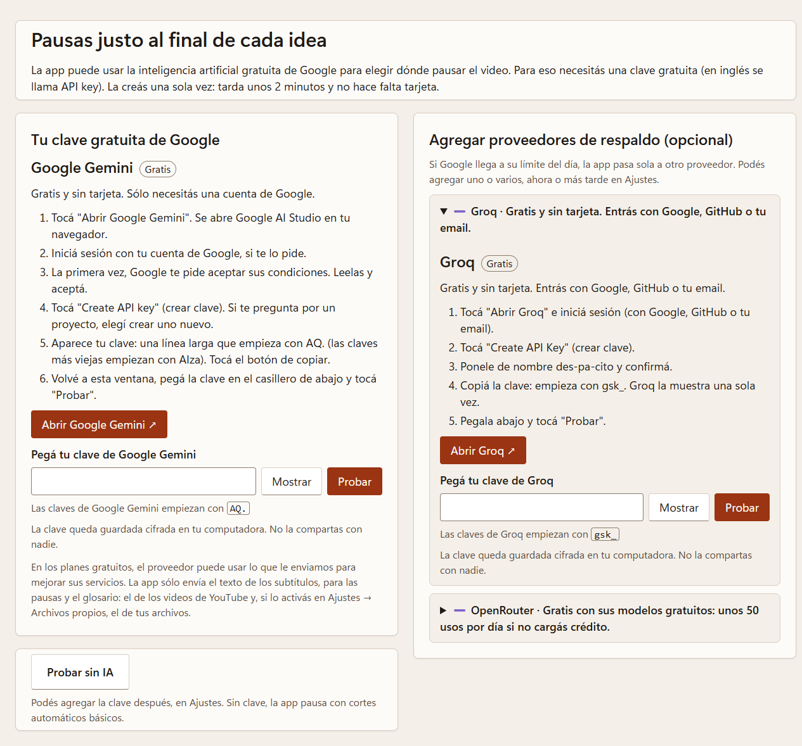
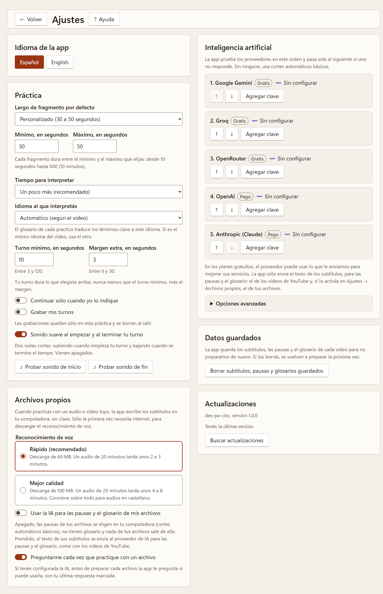

# Proveedores de respaldo (opcional)

Con la [clave gratuita de Google](obtener-api-key-google.md) alcanza. Pero si querés que la app **nunca se
quede sin inteligencia artificial**, podés sumar claves de otros proveedores gratuitos. Si uno llega a su
límite o falla, la app **pasa sola** al siguiente. Podés cambiar el orden en **Ajustes → Inteligencia
artificial**.

Cada proveedor tiene su mini asistente dentro de la app (en el primer inicio, a la derecha de la clave de
Google, y en **⚙ Ajustes → Inteligencia artificial**), con los pasos en pantalla y un botón que abre la
página oficial:

En **⚙ Ajustes**, en **"Inteligencia artificial"** (a la derecha, con la ventana ancha), ves todos tus
proveedores, su estado y el orden en que se usan:

En todos los casos:

- La clave es **como una contraseña**: no la compartas.
- Muchas veces la página **la muestra una sola vez**. Copiala apenas aparece.
- En la app: **Ajustes → Inteligencia artificial → "Agregar clave"**, pegá la clave y tocá **"Probar"**.
- En los planes gratuitos, el proveedor puede usar el texto enviado (los subtítulos) para mejorar sus
  servicios.

| Proveedor | ¿Gratis? | Qué necesitás | La clave empieza con |
|---|---|---|---|
| [Groq](#groq) | Sí | Cuenta (Google, GitHub o email) | `gsk_` |
| [OpenRouter](#openrouter) | Sí, con modelos gratuitos y un límite diario bajo | Cuenta (Google, GitHub o email) | `sk-or-` |
| [OpenAI](#openai-pago) | No, pago | Cuenta con saldo | `sk-` |
| [Anthropic (Claude)](#anthropic-claude-pago) | No, pago | Cuenta con saldo | `sk-ant-` |

---

## Groq

Muy rápido y gratuito. No pide tarjeta. En su plan gratuito alcanza para videos cortos (hasta unos 10
minutos de charla); con videos más largos la app usa otro proveedor o los cortes automáticos.

1. Entrá a <https://console.groq.com/keys> e **iniciá sesión** (con Google, GitHub o tu email).
2. Tocá **"Create API Key"**.
3. Ponele un nombre, por ejemplo `des-pa-cito`, y confirmá.
4. **Copiá la clave** (empieza con `gsk_`). Se muestra una sola vez.
5. Pegala en la app y tocá **"Probar"**.
   <!-- img: img/groq-01-crear-clave.png -->

## OpenRouter

Da acceso a varios modelos; la app usa sólo los **gratuitos**. Sin cargar saldo, permite unos **50 usos
por día** (cada video que preparás usa uno o pocos).

1. Entrá a <https://openrouter.ai/settings/keys> e **iniciá sesión**.
2. Tocá **"Create API Key"** (o "Create Key").
3. Ponele un nombre, por ejemplo `des-pa-cito`. Si te pregunta por un **límite de crédito**, podés poner
   `0`: la app sólo usa modelos gratuitos.
4. **Copiá la clave** (empieza con `sk-or-`). Se muestra una sola vez.
5. Pegala en la app y tocá **"Probar"**.
   <!-- img: img/openrouter-01-crear-clave.png -->

---

## OpenAI (pago)

Sólo si ya tenés una cuenta con saldo: no tiene plan gratuito para usar desde otras apps.

1. Entrá a <https://platform.openai.com/api-keys> e iniciá sesión.
2. Tocá **"Create new secret key"**, ponele un nombre y confirmá.
3. **Copiá la clave** (empieza con `sk-`). Se muestra una sola vez.
4. Pegala en la app y tocá **"Probar"**.

## Anthropic (Claude) (pago)

Sólo si ya tenés una cuenta con saldo.

1. Entrá a <https://platform.claude.com/settings/keys> e iniciá sesión.
2. Tocá **"Create key"**, ponele un nombre y confirmá.
3. **Copiá la clave** (empieza con `sk-ant-`). Se muestra una sola vez.
4. Pegala en la app y tocá **"Probar"**.

---

## Si algo no anda

- **⚠️ "La clave no funciona":** revisá que la copiaste completa, sin espacios, y que empiece como dice la
  tabla de arriba. Si no, creá una nueva.
- **⏳ "Sin cupo hasta las…":** es normal en los planes gratuitos. La app usa el siguiente proveedor de tu
  lista y vuelve a probar con este más tarde.
- **¿Quiero sacar una clave?** En **Ajustes → Inteligencia artificial**, tocá **"Quitar clave"**. Si además querés
  anularla del todo, borrala en la página del proveedor (los mismos links de arriba).

> Los nombres de los botones pueden cambiar un poco: los proveedores actualizan sus páginas seguido.
